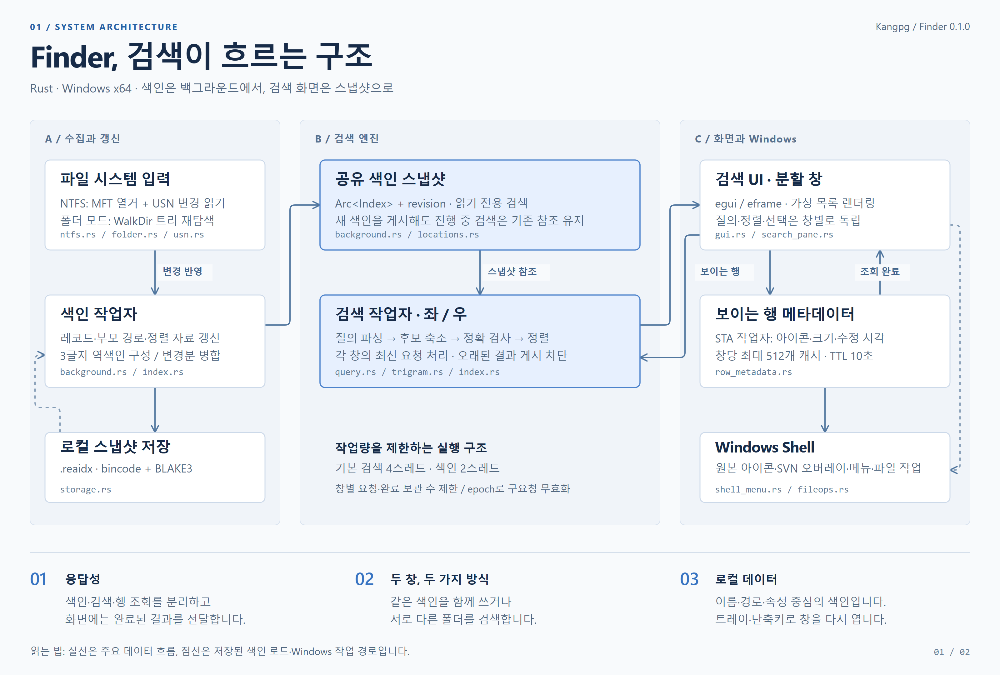
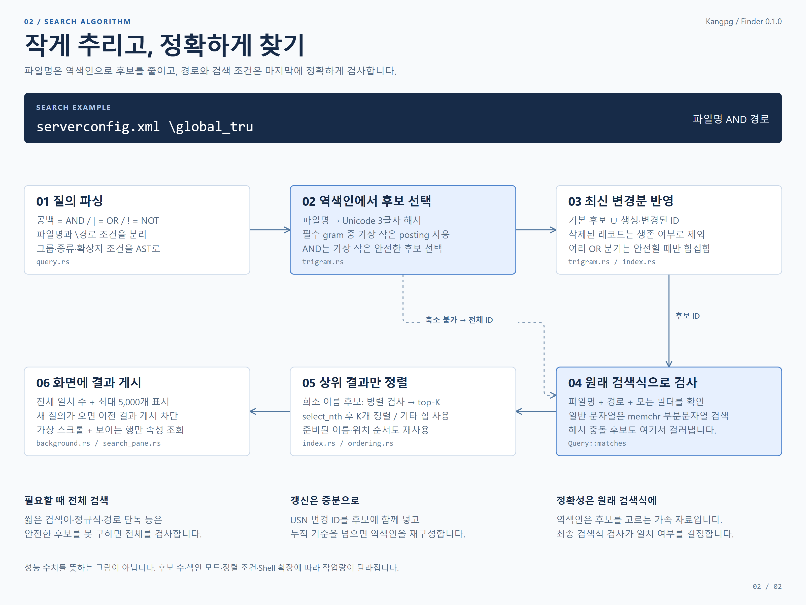

# Finder 사용법 및 구현 상세

Rust로 구현한 Windows x64 로컬 파일명·폴더 검색 프로그램입니다. NTFS MFT를 Windows API로 열거하고, USN 저널의 변경을 반영합니다. 관리자 권한 없이 선택한 폴더를 색인하는 모드도 있습니다.

## 구조와 검색 알고리즘

[개발 경과 · 이슈 추적 · Everything 비교 보고서](./reports/2026-10-29/README.md)에서 발전 방향, 구현 상태와 미종결 이슈, 공식 문서 기준 비교를 확인할 수 있습니다.

실제 소스에 맞춘 [구조 설명과 코드 근거](./architecture/README.md)입니다. 각 그림은 PNG, 수정 가능한 SVG, 외부 리소스 없이 열리는 HTML로 제공합니다.





## 설치판과 포터블

제작자·배포자는 **Kangpg**입니다. Windows 10 이상 x64를 대상으로 합니다.

- **설치판**: `Finder-<version>-Setup-x64.exe`를 실행합니다. 기본 설치 위치는 `%LOCALAPPDATA%/Programs/Kangpg/Finder`입니다. 현재 사용자 시작 메뉴에 등록하고 바탕 화면 바로 가기는 선택할 수 있습니다. Windows 설정의 앱 목록에서 제거할 수 있습니다.
- **포터블**: `Finder-<version>-Portable-x64.zip`을 풀고 `finder.exe`를 실행합니다. 설치 표식이 없는 포터블 실행은 기존처럼 실행 파일 옆 `data` 폴더를 사용합니다.
- 설치판의 설정과 USN 백업은 `%LOCALAPPDATA%/Kangpg/Finder/data`에 저장하며 제거 시 유지합니다. 설치 파일에 개인 설정·검색 기록·사용자 색인을 포함하지 않습니다. 배포 실행 파일은 CRT를 정적으로 링크하여 VC++ 런타임 추가 설치를 요구하지 않습니다.
- 서명 인증서를 포함하지 않은 배포본입니다. 설치 파일의 제품·회사 정보와 앱 목록 배포자는 Kangpg이며, Authenticode 서명은 별도 인증서로 수행해야 합니다.

## 실행

프로젝트 폴더의 **`finder.exe`를 더블클릭**하면 CMD 창 없이 GUI가 열립니다. 릴리즈 GUI는 Windows GUI 서브시스템으로 빌드하며, 명령줄 기능은 `finder-cli.exe`로 제공합니다. `Start-GUI.cmd`는 GUI 실행 후 즉시 종료하는 보조 런처입니다. 빌드된 실행 파일을 사용하는 데 Rust 설치는 필요하지 않습니다.

Windows 화면 출력은 Direct3D 12를 기본으로 사용합니다. 기존 OpenGL 경로와 비교하거나 호환성 문제를 확인할 때는 `.\finder.exe --renderer opengl`로 실행할 수 있고, `--renderer direct3d`로 기본 경로를 명시할 수도 있습니다. 실행 중인 앱을 완전히 종료한 다음 선택한 인자로 다시 실행하세요. 이 옵션은 앱의 출력 방식만 고르며 그래픽 드라이버·다른 앱의 설정을 변경하지 않습니다.

소스에서 다시 빌드하려면 Rust 1.95 이상과 MSVC C++ 빌드 도구가 필요합니다. 배포 빌드에는 NSIS 3.13도 필요합니다. 빌드 도구는 자동 설치하지 않습니다.

```powershell
cargo build --release --locked
.\target\x86_64-pc-windows-msvc\release\finder.exe
```

`Start-GUI.ps1`도 릴리즈 GUI를 실행하는 보조 런처입니다. 오른쪽 위 **색인 관리**에서 폴더 경로 또는 NTFS 드라이브 문자를 선택하세요. 마지막으로 색인에 성공한 폴더는 데이터 폴더의 preferences.json 안 last_folder에 저장하며 다음 실행 때 자동으로 다시 색인합니다. 명시한 --folder/--drive/--index 실행 인자를 우선하고 저장된 폴더가 없으면 현재 작업 폴더를 사용합니다. 폴더 접근에 실패해도 이전에 저장한 성공 경로를 덮어쓰지 않습니다. 파일명 입력 시 검색하고, 파일·폴더는 아이콘으로 구분한 왼쪽 정렬 목록에 표시합니다. 긴 이름과 경로는 마우스를 올리면 전체 내용을 볼 수 있습니다. 더블클릭 또는 Enter로 기본 앱에서 열 수 있습니다. 일반 우클릭은 Windows 기본 클래식 메뉴이며 TortoiseSVN·압축 프로그램 등 설치된 Shell 확장의 메뉴가 함께 나옵니다. **속성** 또는 **Alt+Enter**는 Windows 기본 속성창을 엽니다. **Ctrl+우클릭**은 앱 전용 메뉴이며 경로 복사·탐색기 보기·일괄 이름 변경 등을 사용할 수 있습니다. Windows 메뉴의 **Finder** 하위 메뉴에도 경로·이름 복사와 이름 변경이 있습니다. 목록은 첫 5,000개 결과를 가상 스크롤로 표시하며, 전체 일치 개수는 따로 계산합니다.

NTFS 드라이브 색인은 Windows가 허용하는 볼륨 읽기 권한(일반적으로 관리자 권한)과 이미 활성화된 USN 저널이 필요합니다. 일반 색인·갱신은 저널을 생성하거나 변경하지 않습니다. 설정 → 고급 설정에서 조회한 기존 저널의 크기를 명시적으로 적용할 때만 NTFS 설정 변경을 요청합니다. 볼륨 접근이 거부되면 폴더 모드를 사용하세요.

## 검색 화면 기능

큰 검색창 아래에서 파일 종류와 정렬을 고릅니다. 대소문자·경로·정규식·추가 열은 **검색 옵션**, 저장한 검색은 **최근 · 즐겨찾기**에서 찾을 수 있습니다. 색인 폴더·드라이브·캐시 관리는 오른쪽 위 **색인 관리**로 옮겼으며 자동 갱신은 **설정** 탭, 색인 관리, 도움말 메뉴에서 켜고, 간격은 **1초 이상**으로 직접 입력합니다. 초 숫자를 더블클릭하면 입력할 수 있으며 설정한 간격은 다음 실행에도 유지됩니다. 현재 원본은 상단 위치 표시, 진행·파일 작업 메시지는 하단 상태 표시줄에 보입니다.

파일명과 경로를 다른 밝기로 구분하고 크기 열 제목과 값도 왼쪽에 맞췄습니다. 긴 값은 한 줄로 줄여 표시하며 툴팁에는 전체 경로와 조회 상태를 보존합니다. 자동 갱신 중에도 기존 결과와 선택을 유지하고 새 결과가 도착하면 그때의 선택을 경로로 복원합니다.

- **분할 보기**를 켜면 두 검색창을 나란히 사용합니다. 각 창의 검색어·필터·정렬·검색 옵션·선택은 독립적이며 가운데 경계선을 끌어 폭을 조절합니다. F6으로 검색창을 전환합니다. 상단 **색인 공유**를 켜면 왼쪽 색인을 양쪽에서 사용하고, 끄면 두 창이 각각 다른 폴더·드라이브·색인 파일을 사용할 수 있습니다. 각 창 위 **색인…** 또는 색인 관리의 왼쪽/오른쪽 탭에서 대상을 고릅니다. 공유를 다시 켜도 오른쪽의 독립 색인과 설정은 보관하며 다시 독립 모드로 돌아갈 때 갱신합니다. 분할·공유 설정과 양쪽 마지막 성공 폴더는 다음 실행에도 유지됩니다.
- 목록의 **빈 영역을 드래그**하면 사각형으로 여러 항목을 선택합니다. Ctrl은 추가/해제, Shift는 기존 선택에 추가하며 화면 위·아래 끝에서는 자동으로 스크롤합니다. 가로·세로 스크롤바는 선택 영역 밖에 고정해 막대를 끌 때 선택 드래그가 시작되지 않습니다. Esc로 드래그 선택을 취소합니다.
- **파일 이름이나 아이콘을 드래그**하면 선택한 파일들을 함께 끌 수 있습니다. 다른 창의 폴더 위에 놓으면 복사하고 **Shift를 누르면 이동**합니다. 파일 행 위에 놓으면 그 파일의 상위 폴더가 대상입니다. 탐색기로 끌어내기는 Windows 기본 드래그를 사용합니다. 탐색기에서 앱 안으로 끌어오는 드롭은 아직 지원하지 않습니다.
- 전체/파일/폴더/이미지/문서/오디오/동영상/압축/실행 파일 필터.
- **이름·위치·크기·종류·수정한 날짜** 열 제목을 클릭해 정렬합니다. 다른 열을 누르면 오름차순으로 시작하고 같은 열을 다시 누르면 방향이 바뀝니다. 종류·수정일은 검색 옵션에서 추가 열을 켜면 표시됩니다. 정렬 메뉴에서도 열과 방향, 폴더 먼저를 선택할 수 있습니다. 전체 일치 항목을 정렬한 뒤 첫 5,000개를 표시하며 양쪽 창의 정렬은 따로 저장합니다. 크기는 파일의 논리 크기 기준이고 폴더 및 조회 불가 항목은 마지막입니다. 폴더 먼저를 켜면 폴더가 먼저 나옵니다. 크기·수정일 정렬은 색인이 보관한 메타데이터를 재사용합니다. 폴더 모드는 열거 중 이미 확보한 정보를 저장하고, 메타데이터가 없는 기존 저장 색인·NTFS 항목은 필요한 때 한 번 조회합니다. 이후 정렬 방향 변경·검색·양쪽 창에서 재사용하며 파일 변경은 F5·자동 갱신 때 반영합니다. 크기·종류·수정일 정렬과 위치 캐시를 사용할 수 없는 경우에는 상위 결과의 키만 보유하고 추가 키 문자열을 64 MB로 제한하며, 초과 시 검색 범위를 좁히라는 오류를 표시합니다.
- 대소문자, 단어 전체, 전체 경로, 정규식 옵션. 전체 경로가 포함된 일반 검색어는 자동으로 경로를 검색합니다.
- **크기는 항상 표시**하고 파일 아이콘에는 Windows 상태 오버레이를 사용합니다. 화면에 보이는 항목(창당 최대 128개)부터 별도 작업자가 조회하므로 검색·스크롤은 계속 사용할 수 있습니다. 파일은 논리 크기, 폴더는 하위 일반 파일의 논리 크기 합계입니다. 링크·junction은 따라가지 않고 하드링크는 경로별로 셉니다. 계산 중은 …, 조회 실패는 —, 일부 합계는 **≥** 로 구분합니다. 사유·바이트 수·조회 시점은 툴팁에 표시하며 빈 폴더는 0 B입니다. 폴더당 200,000항목 또는 약 1.5초 뒤 멈추며 개별 파일 시스템 호출 대기는 이 시간을 넘길 수 있습니다. 크기 조건 검색은 아직 지원하지 않습니다. 폴더의 재귀 합계는 표시 전용이며 크기 정렬은 파일 크기를 기준으로 합니다.
- **Windows 원본 파일 아이콘**을 사용합니다. 확장자·실행 파일·사용자 지정 폴더 아이콘과 Windows가 합성한 상태 오버레이를 함께 표시합니다. TortoiseSVN의 정상 체크·수정 !·미관리 ?·추가·삭제·충돌 표시도 설치된 Shell 확장 프로그램이 제공합니다. 별도 SVN 열이나 수동 배지는 붙이지 않습니다. 작업 사본의 하위 변경 전파와 표시 여부는 탐색기처럼 해당 확장의 설정·캐시·Windows 오버레이 등록 상태를 따릅니다.
- 아이콘과 크기는 창당 최대 512개 항목을 10초간 캐시하며 색인 revision 변경 시 무효화합니다. Windows 아이콘은 STA 백그라운드 작업자에서 조회하고 32×32 픽셀로 전달합니다. GPU 텍스처와 표시 정보도 창당 최대 512개까지 보관하여 화면 밖으로 나간 뒤 다시 보이는 아이콘을 재사용합니다. 한도를 넘으면 보이는 항목을 보호하고 오래된 항목부터 해제합니다. 보관 자체가 조회 시점을 갱신하지 않으며 최신 여부는 작업자의 10초·revision 검사로 판단합니다. F5로 다시 조회할 수 있고 스크롤/검색으로 대상이 바뀌면 이전 조회를 항목 사이에서 취소합니다. Windows Shell 확장 함수 자체가 대기 중인 동안에는 강제로 끊지 않습니다. 이 프로그램은 SVN CLI 설치나 별도 svn status 실행 없이 Windows 아이콘을 사용합니다.
- **검색 옵션 → 수정일 · 파일 종류 열**은 추가 열을 표시합니다. 열을 켜고 꺼도 재검색하지 않습니다. 수정일은 보이는 행 작업자의 조회값을 로컬 시간으로 표시하고, 조회 중에는 색인에서 확보한 값을 사용합니다. 정렬용 메타데이터 조회 성공·실패는 현재 색인에서 재사용하며 갱신 때 다시 확인합니다. 파일 내용을 읽지는 않습니다.
- Ctrl 클릭으로 개별 추가/해제, Shift 클릭 또는 Shift+방향키로 범위 선택, Ctrl+A로 표시된 결과 전체 선택(최대 5,000개). 선택 항목은 자동 갱신 시 경로를 기준으로 유지하며, 여러 항목 우클릭 시 선택을 보존합니다.
- Ctrl+우클릭으로 여는 앱 메뉴의 단축키는 구분선 없는 오른쪽 전용 열에서 왼쪽 정렬합니다. 메뉴 이름 길이에 관계없이 같은 위치에서 시작하며 단축키 쪽을 눌러도 해당 메뉴가 실행됩니다.
- Ctrl+C / Ctrl+X는 실제 파일·폴더 복사/잘라내기입니다. 탐색기와 같은 CF_HDROP 파일 클립보드를 사용합니다. Ctrl+V 또는 우클릭 붙여넣기는 선택한 폴더에 붙이며, 파일을 선택했다면 그 파일의 상위 폴더를 사용합니다. 클립보드 읽기·파일 작업은 별도 STA Worker에서 실행합니다. 복사 시 같은 이름이 있으면 기존 파일을 유지하고 새 이름으로 복사합니다.
- F2 또는 우클릭 이름 변경: 한 항목은 새 이름 지정, 여러 항목은 기본 이름+번호 또는 찾아 바꾸기. 적용 전 미리보기가 나오고 확장자 유지도 선택할 수 있습니다. 상위 폴더와 그 내부 파일을 동시에 이름 변경하는 경우는 거부합니다. 내용 수정은 우클릭의 **편집 앱으로 열기**를 사용합니다.
- 폴더 더블클릭·Enter·앱 메뉴 열기는 해당 폴더의 Windows 식별자(PIDL)와 explore 동작을 사용합니다. 같은 위치에 동명 배치 파일(예: deploy 폴더와 deploy.bat)이 있어도 확장자를 보충하는 일반 실행 경로로 넘기지 않습니다. 선택 후 실제 파일/폴더 종류가 바뀌었으면 열기를 중단하고 갱신을 안내합니다. 파일의 기본 앱 열기와 편집도 정확한 선택 항목 식별자를 사용합니다.
- Windows 기본 우클릭 메뉴는 설치된 Shell 확장이 구성하고 명령도 해당 확장이 실행합니다. Windows 11의 작은 아이콘 중심 메뉴 대신 **추가 옵션 표시**에 해당하는 클래식 메뉴입니다. SVN 메뉴·속성 탭의 종류와 표시 여부는 확장 설정과 선택 항목에 따릅니다. 외부 확장의 작업은 앱이 완료 시점을 알 수 없어 메뉴 명령 전달 후 갱신하고, 나중에 바뀐 항목은 자동 갱신 또는 F5로 확인합니다.
- Windows 파일 작업의 진행/충돌/취소 UI를 사용합니다. 오류·취소 시 일부 항목이 처리됐을 수 있어 완료 후 성공 여부와 관계없이 색인을 갱신합니다. 완전 종료 시 진행 중인 파일 작업과 마지막 설정 저장을 정리한 후 종료합니다.
- 파일 클립보드는 최대 5,000개/경로 목록 8 MB입니다. 이후 다른 내용이 복사되면 대기 중이던 이전 복사로 덮어쓰지 않으며, 이동 완료 뒤에도 클립보드가 바뀌지 않은 경우에만 잘라내기 목록을 비웁니다.
- 최근 검색 32개(Enter 또는 파일 작업 때 기록), 검색어·옵션·필터·정렬을 함께 저장하는 즐겨찾기 32개. 즐겨찾기 관리에서 추가·삭제할 수 있습니다.
- 설정은 데이터 폴더의 `preferences.json`에 저장합니다. 설치판과 포터블의 데이터 위치는 위 설치 안내를 따릅니다. 저장 작업도 백그라운드에서 수행하며, 기존 파일을 `preferences.json.bak`에 백업한 뒤 원자적으로 교체합니다. 알 수 없는 JSON 필드를 보존하고, 다른 창/프로그램이 변경한 파일이나 지원하지 않는 버전을 덮어쓰지 않습니다.

| 키 | 동작 |
| --- | --- |
| Ctrl+Alt+Space (기본값, 변경 가능) | 어디서든 검색 창 열기 |
| Ctrl+F / Ctrl+L | 검색창으로 이동 |
| ↑ / ↓ | 결과 선택 (화면 안에서는 스크롤 유지, 화면 밖이면 최소 이동) |
| Enter / 더블클릭 | 폴더는 탐색기에서 열기, 파일은 기본 앱으로 열기 |
| Ctrl+Enter | 탐색기에서 보기 |
| Ctrl / Shift 클릭 | 여러 항목 선택 / 범위 선택 |
| Ctrl+A | 표시한 결과 전체 선택 |
| Ctrl+C / Ctrl+X | 파일 복사 / 잘라내기 |
| Ctrl+V | 선택 폴더에 붙여넣기 (파일 선택 시 상위 폴더) |
| F2 | 이름 변경 및 일괄 이름 변경 |
| F6 | 왼쪽/오른쪽 검색창 전환 |
| Alt+Enter | 선택 항목의 Windows 속성창 |
| Ctrl+우클릭 | 앱 전용 파일 메뉴 |
| Shift+우클릭 | Windows 확장 메뉴 |
| Esc | 드래그 취소 |
| Ctrl+Shift+C | 선택 결과 경로를 여러 줄로 복사 |
| F5 | 색인 갱신 |
| F1 | 검색 도움말 |

## 백그라운드 실행과 설정

설정 → **언어**에서 **한국어 / English**를 선택할 수 있습니다. 선택 즉시 화면·앱 메뉴·트레이 메뉴·상태/오류 문구에 적용되며 자동 저장됩니다. 재실행이나 재색인은 필요하지 않고 검색어·결과·선택 상태를 유지합니다. 기존 설정은 한국어를 기본으로 사용합니다. 앱의 검색·설정·도움말·트레이·상태/오류 메시지를 번역하며 파일 이름·경로·검색어는 원문을 유지합니다. Windows 기본 우클릭 메뉴, 속성창과 SVN Shell 확장은 해당 Windows/확장 프로그램의 언어 설정을 따릅니다.

상단 **설정** 탭에서 창 닫기 동작, 전역 단축키와 자동 갱신을 관리합니다. 기본값은 **창 닫기 → 숨기고 계속 실행**, 창 열기 단축키는 **Ctrl + Alt + Space**입니다. 색인과 검색 상태를 메모리에 유지하므로 단축키로 창을 바로 다시 엽니다. 최소화된 창도 복원합니다. Windows 로그인 시 자동 시작을 등록하지 않으며, 완전 종료 뒤에는 실행 파일을 다시 실행해야 합니다.

단축키는 Ctrl/Alt/Shift/Win 조합과 키를 선택한 뒤 **단축키 적용**을 누릅니다. Ctrl·Alt·Win 중 하나가 필요하며 F12는 Windows 예약 키여서 제공하지 않습니다. Windows의 RegisterHotKey를 사용하고 키보드 후킹은 하지 않습니다. 충돌하면 오류를 표시하고 이전 단축키를 유지하며, 등록에 성공한 설정만 저장합니다. 창과 트레이에는 같은 검색 로고를 사용합니다. 트레이 아이콘 클릭은 검색 창을 열고 우클릭은 **열기 / 설정 / 종료** 메뉴를 표시합니다. 트레이의 종료는 프로세스를 완전히 종료합니다. 단축키와 트레이를 모두 준비하지 못하면 복귀 수단이 없는 상태로 숨겨지지 않습니다. 트레이·단축키 등록은 종료할 때 해제합니다.

## USN 고급 설정과 크기 단위

설정 → **고급 설정 → NTFS USN 저널**에서 드라이브를 선택하고 **현재 설정 조회**를 누릅니다. 관리자 권한으로 실행해야 조회·변경할 수 있습니다. 최대 크기와 할당 변화폭은 B/KB/MB/GB/TB 중 선택하며 **저널 크기 적용** 전에는 시스템 설정을 쓰지 않습니다. 128 MB / 8 MB 버튼은 입력값만 채웁니다. 단위는 1,024배 기준이며 단위 전환은 원래 바이트 수를 정확히 보존합니다. 파일·폴더·메모리·제한 오류도 같은 단위를 사용합니다.

적용 전에 볼륨 GUID·일련번호·저널 ID와 기존 설정을 재검사하고 `data/usn-backups`에 이전 값과 요청값을 별도 JSON으로 백업합니다. 조회 이후 다른 프로그램이 설정을 바꿨거나 백업에 실패하면 중단합니다. 성공한 변경 요청과 재조회 결과를 구분하며 NTFS 정리 시점까지 크기 반영이 지연될 수 있습니다. 볼륨 공용 설정이며 자동 적용·저널 삭제·비활성화 기능은 제공하지 않습니다. Windows 크기 변경 API는 저널 생성과 동일한 IOCTL이므로 존재 재검사와 요청 사이의 외부 프로그램 저널 삭제 경합을 원자적으로 차단하지는 못합니다.

## CLI

```powershell
$app = '.\target\x86_64-pc-windows-msvc\release\finder-cli.exe'
& $app index --folder 'D:\Projects' --output '.\projects.reaidx'
& $app search --index '.\projects.reaidx' 'ext:rs;cpp !target' --json
& $app search --index '.\projects.reaidx' --filter images --descending --json
& $app search --index '.\projects.reaidx' '^(report|notes)\.' --regex --whole-word
& $app search --index '.\projects.reaidx' 'Projects' --match-path --folders-first
& $app refresh --index '.\projects.reaidx'
& $app stats --index '.\projects.reaidx'

# NTFS 볼륨 접근 권한이 있는 콘솔에서
& $app journal --drive D: # 현재 USN 설정 조회만 수행
& $app index --drive D: --output '.\drive-d.reaidx'
& $app search --index '.\drive-d.reaidx' '한국 report' --limit 200
& $app watch --index '.\drive-d.reaidx' --interval 3

# CPU와 메모리 예산에 맞춰 검색·정렬 작업자 수를 선택합니다(기본 4, 최대 32).
& $app --threads 4 bench --index '.\projects.reaidx' --runs 10
```

폴더 색인은 저장 시점의 스냅샷입니다. `refresh` 또는 GUI 자동 갱신을 사용하면 폴더 트리를 다시 읽습니다. NTFS `search`는 기본적으로 저장된 USN 위치부터 메모리에서 갱신한 후 검색합니다. `--snapshot`은 디스크 확인 없이 저장된 상태를 명시적으로 검색합니다. CLI `search`는 캐시 파일을 쓰지 않으므로 지속적으로 저장하려면 `refresh`/`watch`를 사용하세요.

| 검색식 | 의미 |
| --- | --- |
| `report 한국` | 이름에 두 문자열 모두 포함 |
| `"annual report"` | 공백을 포함한 문자열 |
| `foo \| bar` | 둘 중 하나 |
| `!temp` | temp를 포함하지 않는 이름 |
| `!(folder: \| ext:tmp)` | 그룹의 결과 제외 |
| `file:` / `folder:` | 파일 또는 폴더만 |
| `ext:rs;cpp` | 확장자 여러 개 |
| `*.txt` | 이름 전체에 와일드카드 적용 |
| `image:` / `doc:` / `audio:` / `video:` / `zip:` / `exe:` | 파일 종류 매크로 |
| `path:Projects` | 전체 경로에 문자열 포함 |
| `regex:"report.*\.txt$"` | 이름에 정규식 적용 |

기본 문자열 검색은 Unicode 소문자 변환을 사용합니다. `--case-sensitive`는 대소문자를 구분합니다. Windows의 모든 언어별 정렬 규칙과 같은 의미를 보장하지는 않습니다. 검색식의 `regex:` 안에 쓰는 연산 문자는 따옴표 안에 넣으세요. `--regex` 또는 GUI 정규식 옵션을 사용하면 검색어 전체를 하나의 정규식으로 해석합니다.

## 구조와 최적화

- 파일명에 **Unicode trigram 역색인**을 보조로 사용합니다. 소문자화한 이름을 세 Unicode 문자씩 나누어 해시 버킷의 파일 ID 목록을 만들고, 드문 조각의 후보를 기존 검색식으로 다시 검사합니다. 해시 충돌은 후보만 늘리며 일치하지 않는 결과를 반환하지 않습니다. AND는 안전한 제한 조건을 선택하고 OR는 모든 가지가 제한 가능한 경우에만 합칩니다. 1~2글자·대소문자 구분·정규식/와일드카드·경로 조건 등으로 후보를 안전하게 줄일 수 없거나 후보가 너무 많으면 기존 전체 검색을 사용합니다. AND의 다른 일반 파일명 조건으로 후보를 줄일 수는 있습니다.
- 역색인 빌드 버퍼는 128 MB, 쿼리 후보 계획의 누적 임시 배열은 16 MB 예산입니다. 예산/할당 문제는 결과를 잘라내지 않고 전체 검색으로 돌아갑니다. 같은 색인의 분할창과 변경 전후 스냅샷은 불변 기본 역색인을 공유합니다. 작은 파일 생성·이름 변경은 최대 64~4,096개(기본 레코드 수에 따라 결정)의 변경 ID 목록으로 보완하고 누적 한도를 넘으면 백그라운드에서 다시 준비합니다. 삭제는 최종 검사에서 걸러내고 레코드 압축 시 ID에 맞춰 재구축합니다. 표시 메모리에 이 보조 색인을 포함하며 CLI stats의 filename_index에서 상태·추정 바이트·변경 수를 확인할 수 있습니다.
- 기존 .reaidx 파일 형식은 유지합니다. 역색인은 저장 파일에 넣지 않고 로드/색인 준비 때 메모리에 만듭니다. 처음 불러올 때 준비 시간이 추가되며 준비·로드 취소는 작업 ID를 확인합니다. 이름/위치 검색 결과를 발행하기 위해 화면 밖 수정일 정보를 미리 읽지 않습니다. 표시용 수정일·파일 크기는 보이는 행의 작업자가 갱신하고, 수정일/크기 정렬에서만 필요한 전체 일치 항목의 정보를 조회·캐시합니다.
- 파일명은 연속 UTF-16 풀, 검색용 이름은 연속 소문자 UTF-8 풀에 저장합니다. 경로는 부모 FRN으로 필요할 때 복원합니다.
- FRN의 전체 64비트(재사용 구분 시퀀스 포함)를 보존합니다. 누락·순환 부모를 임의의 경로로 바꾸지 않습니다.
- 이름과 위치는 색인 갱신 때 준비한 정렬 순서를 재사용하고, 정해진 작업자 수로 검색합니다. 위치는 같은 부모 폴더의 경로를 한 번만 복원·보관해 정렬 키와 표시 경로에 공유하며, 방향을 바꿀 때는 폴더 그룹 순서만 바꿉니다. 같은 위치 안의 이름 순서는 유지합니다. 폴더 이름 변경·이동·삭제 및 레코드 압축 시 다시 준비하며 두 창과 변경 없는 색인 세대는 불변 캐시를 공유합니다. 부모 경로 캐시 준비의 64 MB 예산을 넘거나 일반적이지 않은 드라이브 접두 파일명이 있으면 기존의 메모리 제한 정렬 방식으로 돌아가므로 해당 경우 위치 정렬은 느릴 수 있습니다.
- 결과 개수와 반환 ID만 수집해 모든 일치 항목의 경로 문자열을 만들지 않습니다.
- GUI의 색인/저장 작업과 검색 작업은 서로 다른 백그라운드 스레드 및 CPU 작업 풀에서 실행합니다. 갱신 중에도 기존 불변 색인으로 검색하고, 새 색인이 완성되면 짧은 포인터 교체 후 현재 검색어를 다시 적용합니다. 기본 검색 작업자는 4개, 색인 정렬 작업자는 2개이며 색인 풀은 최대 4개입니다. 디렉터리 열거 자체는 순차 I/O입니다.
- 드래그용 파일 정보 준비·복사·이동·이름 변경·파일 열기·탐색기 보기·파일 정보·설정 저장은 별도 STA 작업 스레드로 처리합니다. 탐색기와의 네이티브 드래그 루프는 창의 STA에서 실행되며 Windows가 그동안 메시지를 처리합니다. 화면이 보유하는 작업은 최대 16개이며 종료 시 마지막 설정 저장을 큐에 넣고 작업 스레드를 정리합니다.
- 색인 작업과 각 검색창은 대기 요청과 완료 이벤트를 각각 1개로 제한합니다. 공유/독립 모드 모두 검색 CPU 풀은 기본 총 4개, 색인 CPU 풀은 기본 총 2개 작업자로 공유합니다. 독립 모드에서는 불변 스냅샷·대기 큐·완료 이벤트·revision을 각각 소유하며 다른 창의 갱신이나 실패가 현재 결과를 바꾸지 않습니다. 한 창의 검색어 변경은 그 창의 검색만 취소하고 다른 창과 진행 중인 갱신은 유지합니다. 실패·취소된 갱신은 현재 색인을 손상시키거나 부분 결과를 게시하지 않습니다.
- NTFS 변경이 있을 때는 새 색인 복사본에 저널을 적용하므로 갱신 중 메모리가 증가할 수 있습니다. 저널 변경이 없으면 전체 색인을 복사하지 않습니다. 폴더 모드는 설정한 자동 갱신 간격(기본 3초)마다 전체 트리를 다시 읽습니다.
- 이름 변경·삭제 누적 시 이름 풀과 레코드를 압축합니다. 레코드 최대 1,000만 개, 이름 풀별 최대 512 MB, 캐시 최대 512 MB를 제한하고 초과하면 명시적으로 실패합니다.
- 캐시는 버전·길이·BLAKE3 체크섬을 검증하고 임시 파일을 동기화한 후 원자적으로 교체합니다. 체크섬은 손상 검출용이며 인증 기능은 아닙니다.

크기·수정일 캐시는 현재 실행 중인 색인이 소유합니다. 기존 `.reaidx` 형식은 유지하여 저장 파일에는 새 메타데이터를 추가하지 않습니다. 저장 파일을 다시 로드하면 필요한 항목을 최초 한 번 조회합니다. 메모리는 Windows x64에서 레코드당 32바이트 셀과 용량 여유분이 추가되며 사용량 추정에 포함합니다. NTFS는 USN이 바뀐 레코드만 무효화하고, 실패 관측은 저널 갱신 때 재시도합니다. 서로 다른 독립 색인은 정보를 공유하지 않습니다.

## 현재 범위

각 색인은 하나의 폴더 또는 NTFS 볼륨을 대상으로 합니다. 분할창 독립 모드에서는 두 색인을 동시에 유지합니다. USN V2의 64비트 NTFS ID를 지원합니다. ReFS/128비트 USN 레코드, 모든 하드링크 이름 열거, 파일 내용·크기·날짜 검색, 네트워크 공유의 실시간 추적은 구현하지 않았습니다. 폴더 모드는 링크·junction 안으로 들어가지 않습니다. 접근 실패는 개수와 최대 32개 진단으로 표시합니다.

NTFS 저널이 교체되거나 저장 위치가 보존 범위를 벗어나면 갱신을 거부하며 색인을 다시 만들어야 합니다. NTFS 조회는 갱신 종료 시점까지의 변경을 반영하며, 파일 시스템 전체에 대한 원자적 스냅샷은 아닙니다.

## 검증

```powershell
cargo fmt --check
cargo clippy --all-targets -- -D warnings
cargo test --locked
```

`tests/cli.rs`는 실제 실행 파일로 한글 폴더 색인, 검색·제한, 이름 변경·삭제 후 갱신, 손상된 캐시 거부를 검증합니다. USN 파서의 잘못된 길이·버전·UTF-16 경계 및 FRN 재사용도 테스트합니다. 이 저장소에는 로컬 실행·측정 기록을 포함하지 않습니다.

## 배포 빌드와 소스 복사

```powershell
cargo test --locked -- --test-threads=1
cargo clippy --locked --all-targets -- -D warnings
.\scripts\build-release.ps1 -NsisPath 'C:\Tools\NSIS\makensis.exe'
.\scripts\export-source.ps1 -Destination 'D:\Projects\finder-source'
```

배포 스크립트는 x64 형식·GUI/CLI 서브시스템·Finder/Kangpg 제품 정보·직접 CRT 의존성·숨김 버전 실행을 검사하고, `artifacts/release`에 설치판·포터블 ZIP·해시 manifest를 만듭니다. 의존성의 라이선스·저작권 문서는 `THIRD-PARTY-NOTICES.txt`로 함께 묶습니다. source export는 새 빈 폴더에 소스·Cargo.lock·제품 정보·설치/빌드 스크립트·문서만 복사하고 SHA256 목록을 만듭니다. target, artifacts, 실행 파일, 개인 data, 색인, 로컬 검증 기록과 .git은 복사하지 않습니다. Git 초기화·커밋·업로드는 수행하지 않습니다.


## 해당 폴더 열기와 실행 위치

파일 또는 폴더 한 개를 선택하고 일반 우클릭 메뉴의 **해당 폴더 열기**를 누르면 파일은 상위 폴더에서 선택되고 폴더는 직접 열립니다. Ctrl+우클릭 앱 메뉴에도 같은 항목이 있습니다.

배치파일·프로그램을 더블클릭하거나 Enter로 열 때 파일이 있는 폴더를 작업 디렉터리로 전달합니다. 기본 열기·편집과 Windows 우클릭 메뉴 실행에 적용하며, Finder 전체의 현재 작업 폴더는 변경하지 않습니다. 서로 다른 폴더의 파일을 함께 선택한 Windows 메뉴에는 임의의 공통 작업 폴더를 지정하지 않습니다.
